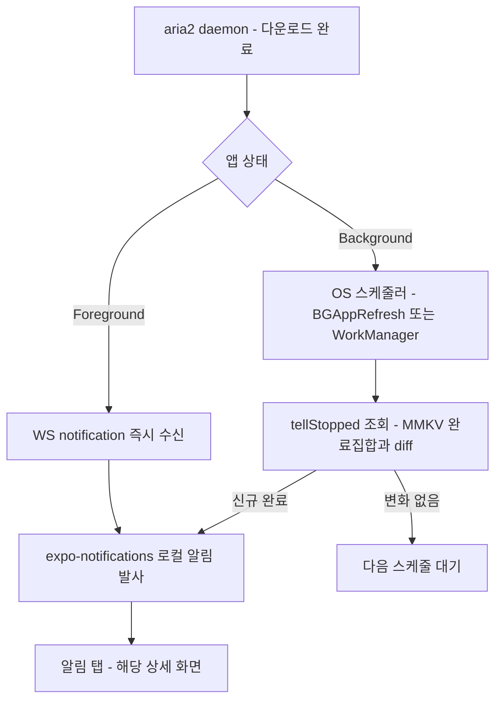

# AriaDM — Design Spec

> **Date**: 2026-08-22
> **Status**: Approved (brainstorming 완료)
> **Product**: AriaDM — aria2 Download Manager (모바일 앱)

## 목차

- [개요](#개요)
- [배경 — 경쟁 현황](#배경--경쟁-현황)
- [목표 / 비목표](#목표--비목표)
- [기능 Roadmap](#기능-roadmap)
- [아키텍처](#아키텍처)
- [화면 설계](#화면-설계)
- [알림 파이프라인](#알림-파이프라인)
- [보안](#보안)
- [에러 처리](#에러-처리)
- [수익 모델 — IAP](#수익-모델--iap)
- [기술 스택](#기술-스택)
- [테스트 전략](#테스트-전략)
- [배포](#배포)
- [결정 로그](#결정-로그)

## 개요

aria2 daemon을 JSON-RPC/WebSocket으로 원격 제어하는 크로스플랫폼 모바일 앱. 단일 TypeScript 코드베이스(React Native + Expo)로 Android/iOS 동시 지원. 오픈소스 + Freemium 모델로 공개 배포한다.

앱 자체는 다운로드 엔진이 아니다 — 서버/NAS에서 구동 중인 aria2의 리모컨이다.

## 배경 — 경쟁 현황

2026-08 조사 기준:

| 플랫폼 | 앱 | 약점 |
| :--- | :--- | :--- |
| Android | Aria2App (오픈소스) | Java 레거시, UI 구식, iOS 부재 |
| Android | Aria2 Remote | beta 방치 |
| iOS | Ariane for aria2 | 심플 리모컨 수준, 그래프·알림 깊이 부족 |
| iOS | AriaX, NeoAria2 | 기능 최소 |
| iOS/Mac | BitRemote | 유료, 독립 생태계 |

**공백**: (1) iOS에서 알림·그래프·멀티 프로필을 갖춘 앱 전무, (2) 양 플랫폼 동일 경험 제공 앱 부재. AriaDM의 P0(핵심 제어 + 완료 알림)가 정확히 이 공백을 겨냥한다.

## 목표 / 비목표

**목표**

1. 복수 서버 프로필 관리와 즉시 전환
2. 실시간 다운로드 목록·제어 (WS 이벤트 구동)
3. 다운로드 완료 알림 (v1: 로컬 알림, 향후: 클라우드 relay)
4. AriaNG 네이밍 컨벤션 계승(Aria+2자리)의 오픈소스 브랜드 확립

**비목표 (v1 제외)**

- On-device 다운로드 엔진 (aria2 binary 번들) — iOS 불가능, Android만 가능하나 범위 초과
- 파일 브라우저 — P2 후보, 별도 백엔드(WebDAV/SFTP) 연동 필요
- 앱 잠금(생체인식), 계정 체계, telemetry/애널리틱스
- 클라우드 relay push 서버 구현 — Pro 로드맵, v1은 로컬 알림만

## 기능 Roadmap

| 단계 | 기능 | 내용 |
| :--- | :--- | :--- |
| P0 | 핵심 제어 | 프로필 CRUD·연결 테스트, 다운로드 목록(진행/대기/완료/중지), URL/magnet/torrent 추가, 일시정지·재개·삭제, 전역 속도 표시 |
| P0 | 완료 알림 | Foreground WS 이벤트 즉시 알림 + Background 폴링 로컬 알림 |
| P1 | 그래프·상세 | 실시간 업/다운 속도 그래프, 다운로드별 상세(peer, piece, 서버 응답) |
| P2 | 파일 브라우저 | 완료 파일 탐색 (WebDAV/SFTP 연동) — Pro 후보 |
| Pro | 클라우드 relay push | 운영 relay가 APNs/FCM 중계 — 유료 |

## 아키텍처

### 모듈 구조

```text
app/                    — expo-router 라우팅
  (tabs)/               — 다운로드 · 추가 · 설정
  modal/                — 프로필 편집, 다운로드 상세
features/
  profiles/             — 서버 프로필 CRUD, 연결 테스트
  downloads/            — 목록·필터·제어 로직
  new-download/         — URL/magnet/torrent 추가
  stats/                — 전역 속도 (P1: 그래프)
  settings/             — 알림·표시 설정, Pro 업그레이드
core/
  rpc/                  — aria2 JSON-RPC client (WS + HTTP fallback)
  notifications/        — 로컬 알림 파이프라인
  iap/                  — RevenueCat wrapper
shared/                 — 공통 UI 컴포넌트, i18n(ko/en), 유틸
```

### RPC 계층

프로필별 `Aria2Connection` 인스턴스가 통신을 독점한다.

- 연결: `ws(s)://host:port/jsonrpc`. 모든 메서드 호출 첫 파라미터에 `token:<secret>` 전달
- 이벤트: aria2가 밀어주는 notification(`onDownloadStart`, `onDownloadComplete`, `onDownloadError`, `onBtDownloadComplete`)을 구독 → TanStack Query 캐시 무효화 → UI 갱신
- 전역 속도: 동일 WS에서 `getGlobalStat` 1초 폴링
- Fallback: WS handshake 실패 또는 연속 3회 끊김 → HTTP 폴링(2초) 강등, 60초마다 WS 재시도
- 재연결: exponential backoff. NetInfo 네트워크 전환 시 즉시 재시도

### 상태 관리

- 서버 상태(다운로드 목록, 통계): TanStack Query — WS 이벤트 기반 invalidation
- 앱 상태(프로필, 설정, entitlement): Zustand v5 + MMKV persistence

## 화면 설계

**탭 3개 + 모달. 네이티브 감성 — iOS는 SwiftUI 스타일(blur tab bar, SF 간격), Android는 Material 3(톤, ripple). 테마 레이어에서 분기하고 레이아웃·로직은 공유한다.**

| 화면 | 구성 |
| :--- | :--- |
| 다운로드 | segmented control(iOS)/Material tabs(Android): 진행·대기·완료·중지. 행 = 파일명, progress bar, 속도, 잔여. swipe/long-press 액션: 일시정지·재개·삭제 |
| 추가 | URL/magnet 입력창, torrent 파일 피커, 옵션(출력 경로, 분할 수) |
| 설정 | 프로필 전환·관리, 알림 on/off, 표시 설정, Pro 업그레이드 |
| 프로필 편집 (모달) | 이름, host, port, rpc-secret, TLS 옵션 + 연결 테스트 버튼 |
| 다운로드 상세 (모달) | 파일 구성, piece 진행, 연결 수, 에러 메시지 (P1 확장: peer·그래프) |

## 알림 파이프라인



1. **Foreground**: WS `onDownloadComplete` → 즉시 로컬 알림
2. **Background iOS**: `BGAppRefreshTask` — OS 재량 주기(수 분~수 시간)로 앱 기상 → `tellStopped` diff → 신규 완료 알림
3. **Background Android**: WorkManager(`expo-background-task`, 최소 15분) 동일 로직 — iOS보다 예측 가능
4. 완료 관측 집합은 MMKV에 저장해 중복 알림 방지
5. OS 제약상 지연 가능성을 설정 화면·스토어 설명에 명시 (심사 안전)

## 보안

- rpc-secret: `expo-secure-store` (iOS Keychain / Android Keystore). AsyncStorage 금지
- TLS: `https`(유효 CA)와 `http` 지원. self-signed 인증서 허용 토글은 v1 미지원 (RN fetch가 인증서 검증 예외 불가) — 사설망에서는 Tailscale 내부 `http` 권장
- v1 telemetry/애널리틱스 없음. Crash reporting은 opt-in 토글(기본 off)
- 오픈소스 공개 시 secret 유출 경로 자체가 부재 (모든 자격은 기기 로컬)

## 에러 처리

- 연결 상태 chip 상시 표시: `connecting / connected / degraded-HTTP / disconnected`
- 프로필 연결 테스트 진단 분기: 인증 실패(secret 오류) vs 도달 불가(포트 차단·TLS·네트워크 — RN fetch 제약으로 상세 원인 분류 불가, 원인 후보 안내)
- aria2 RPC 에러 코드 → ko/en 친화 메시지 매핑 테이블
- 네트워크 전환(NetInfo) → 즉시 재연결

## 수익 모델 — IAP

- v1: **전 기능 무료** 출시. IAP scaffold는 **entitlement 경계 인터페이스**(`isPro()` 등)만 포함 — `react-native-purchases` SDK 설치·RevenueCat 연동은 Pro 기능(relay push) 출시 시점에 추가 (유휴 의존성 방지)
- 유료 전환 시점 = 클라우드 relay push 출시. Pro = relay push + 파일 브라우저(P2)
- 결제(출시 시점): react-native-purchases (StoreKit 2 / Play Billing 래핑) — 자체 검증 서버 불필요

## 기술 스택

전 구성요소 2026-08 최신 버전. 프로젝트 생성 시점에 `create-expo-app` latest로 재확인한다.

| 구성요소 | 선택 |
| :--- | :--- |
| Framework | Expo SDK 57, expo-router v7 (New Architecture 전용) |
| React Native | 0.83+, React 19.2 |
| Language | TypeScript strict |
| 서버 상태 | TanStack Query v5 |
| 앱 상태 | Zustand v5 + react-native-mmkv |
| 알림·보안 | expo-notifications, expo-secure-store, expo-background-task, expo-localization |
| Chart (P1) | victory-native (Skia 기반) |
| IAP | react-native-purchases (RevenueCat) |
| 패키지 매니저 | pnpm |
| 테스트 | Jest (jest-expo 공식 지원), Maestro(E2E) |

## 테스트 전략

| 레벨 | 대상 | 도구 |
| :--- | :--- | :--- |
| Unit | RPC client(WS/HTTP mock), 알림 diff, 프로필 스토리지 | Jest |
| Integration | 실제 aria2 대상 RPC 메서드 계약 테스트 — docker-compose로 aria2 기동 | docker-compose |
| E2E | smoke: URL 추가 → 목록 등장 → 일시정지 → 재개 | Maestro |
| 실기기 | Android WiFi 배포 자동화 | dev:deploy-android-wifi |

### 테스트 환경 (실제 운영 대상 — homelab heritage)

| 항목 | 값 |
| :--- | :--- |
| 대상 | heritage LXC 200 — `p3terx/aria2-pro:test` (aria2 1.36.0) |
| Endpoint | `http://100.96.115.19:6800/jsonrpc` (Tailscale 망 내부) |
| WebSocket | `/jsonrpc` WS upgrade 검증 완료 (101) |
| 인증 | rpc-secret — 컨테이너 `/config/aria2.conf` 소유. **repo에 절대 저장 금지**, 개발 시 ssh로 조회해 로컬 `.env`(gitignore) 사용 |
| 데이터 특성 | 운영 인스턴스 — active/waiting 500+/stopped 600+ → 대용량 목록 pagination 검증에 활용 |

SSH 접근: `ssh heritage` (Tailscale). CI에서는 docker-compose 기동한 격리 aria2만 사용하고, 실운영 인스턴스는 수동/실기기 테스트 전용이다.

## 배포

- GitHub: `deuxksy/AriaDM` — **private 시작, MVP 완성 후 public 전환**
- Apple Developer Program: $99/년 (App Store 필수)
- Google Play Console: $25 일회성
- 수수료: 연 매출 $1M 이하 Small Business Program 15%
- 빌드: EAS Build (무료 티어 quota 내), 초과 시 로컬 빌드
- 스토어 등록명: **AriaDM — aria2 Download Manager** (검색 키워드 aria2 노출)

### 스토어 계정 전략

- 전용 계정: `dev@zzizily.com` (Google Workspace zzizily.com에서 생성) — 개인 계정과 운영 분리
- 등록 유형: Google Play·Apple 모두 **Personal/Individual** (사업자 부재)
- Google Play 신규 개인 계정 요건 — 폐쇄 테스트 **12명 × 14일** 옵트인: 오픈소스 베타 프로그램으로 충족
- Apple Individual: seller에 실명 노출 (Apple 정책, 법인 설립 전 불가피)
- 사업자 설립 시 조직 계정으로 이전 (Play 앱 이전, Apple 이관 모두 공식 지원)

## 결정 로그

| 결정 | 선택 | 근거 | 일자 |
| :--- | :--- | :--- | :--- |
| 제품 형태 | 모바일 앱 Android+iOS | 요구사항 | 2026-08-22 |
| 구조 | 원격 제어 RPC client | iOS on-device 불가, 백그라운드 제약 회피 | 2026-08-22 |
| 스택 | React Native + Expo | 기존 환경 재사용, 이 앱 특성에 충분. Flutter 대비 | 2026-08-22 |
| 범위 | 공개 배포 | 요구사항 | 2026-08-22 |
| 포지셔닝 | 오픈소스 + Freemium | 커뮤니티 신뢰 + 고급 기능 수익화 | 2026-08-22 |
| Push | 로컬 우선 → relay 로드맵 | v1 서버리스, 즉시 알림은 Pro 가치 | 2026-08-22 |
| UI | 네이티브 감성 (기존 AriaNg 계승안 취소) | 플랫폼 관습 존중 | 2026-08-22 |
| 아키텍처 | WebSocket 중심 + HTTP fallback | 실시간성·배터리 효율 | 2026-08-22 |
| 버전 정책 | 전부 최신 | 요구사항 | 2026-08-22 |
| 이름 | AriaDM | AriaNG 컨벤션 계승, DM=Download Manager 자명, 충돌 없음 | 2026-08-22 |
| 테스트 대상 | homelab heritage aria2 (운영 인스턴스) | 실데이터 검증, WS 동작 확인 | 2026-08-22 |
| 스토어 계정 | dev@zzizily.com 전용 + Personal 등록 | 운영 분리·보안, 이후 조직 이전 가능 | 2026-08-22 |
