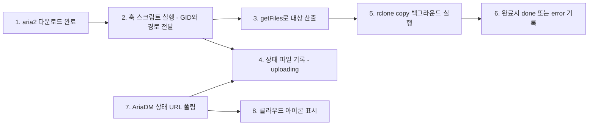

# 클라우드 업로드 연동 (rclone) — Design Spec

> **Date**: 2026-11-21
> **Status**: Revised v2 — 2-Way 검증(Codex gpt-6.2-sol · Antigravity gemini-4-argon-high) blocker 5건·risk 반영
> **Scope**: 다운로드 완료 → 클라우드 자동 업로드(서버 측 rclone) + 앱 업로드 상태 표시 · 설정 마법사
> **수익 분류**: Pro 평생 $9.99 (자동화 카테고리)

## 목차

- [개요](#개요)
- [목표 / 비목표](#목표--비목표)
- [배경 — aria2 검증](#배경--aria2-검증)
- [설계](#설계)
- [파일별 변경 (예상)](#파일별-변경-예상)
- [에지 케이스](#에지-케이스)
- [테스트 전략](#테스트-전략)
- [결정 로그](#결정-로그)

## 개요

다운로드 완료 파일을 사용자 클라우드(Google Drive 1순위, rclone remote 전반)로 자동 업로드한다. 전송은 전부 사용자 aria2 서버의 rclone이 수행하고, AriaDM은 설정 마법사와 업로드 상태 표시를 제공한다. aria2 RPC에는 업로드 기능이 없으므로(배경 참조) `on-download-complete` 이벤트 훅을 경유한다.

전송 경로는 aria2 서버 → rclone → 사용자 클라우드다. AriaDM과 ZZiZiLY 서버는 전송에 관여하지 않는다 — ZZiZiLY 반복 비용 0.

## 목표 / 비목표

**목표**

1. 다운로드 완료 시 서버 측 rclone 자동 업로드 — 앱이 전송을 경유하지 않음
2. 앱 업로드 상태 표시 — 상태 파일 폴링, 클라우드 아이콘
3. 설정 마법사 — 서버 스크립트 생성·복사, rclone 설치·OAuth 가이드
4. rclone remote 일반화 — Google Drive를 1순위 검증 사례로, remote 이름 추상화로 타 클라우드 확장
5. Pro 게이트 지점 정의 — 마법사 진입 + 상태 표시 (v1 동안 `isPro()`가 true 반환해 전 기능 개방, 체크 코드만 삽입)

**비목표**

1. 앱이 Drive API 직접 호출(서버→폰→클라우드 경유) — 대역폭 2배·모바일 백그라운드 제한·OAuth 민감 스코프 심사
2. 업로드 진행률 % 표시 — rclone stats 로그 파싱이 필요, v1은 상태 값(uploading/done/error/deferred)만
3. 업로드 재시도·취소 관리 UI, 멀티 remote 전환 UI (`deferred` 자동 재구동은 서버 스크립트가 담당)
4. SSH 등 서버 원격 설치·실행 — 마법사는 텍스트 생성·복사까지만
5. relay push 연동 — 미래 Pro 기능, 본 spec과 독립

## 배경 — aria2 검증

2026-11-21 공식 문서(https://aria2.github.io/manual/en/html/aria2c.html) 및 aria2 1.36.0 소스 검증 기준:

| 항목 | 결과 |
| :--- | :--- |
| RPC 업로드 메서드 | **없음** — addUri·addTorrent·tellStatus 등 전부 다운로드 제어. upload 관련 옵션은 BT 시딩 한정(`max-upload-limit`) |
| `on-download-complete` 인자 | GID·**선택 파일 수**·**첫 번째 선택 파일 경로** 3개 전달 — `$3`는 디렉터리가 아니라 첫 파일의 전체 경로 (aria2 1.36.0 `util.cc` 확인) |
| BT 시 호출 시점 | `on-download-complete`는 시딩 종료 후. `on-bt-download-complete`는 시딩 전이며 기본 설정에서 해시 검증 성공 시에도 호출 가능(`bt-enable-hook-after-hash-check`) |
| `changeGlobalOption` RPC | 이벤트 훅 변경 **불가** — 허용 목록에 훅 없음 → 훅은 aria2.conf 고정, 앱에서 동적 on/off 불가 |

## 설계

### 1. 아키텍처



### 2. 서버 측 — upload-cloud.sh

앱 마법사가 생성한 텍스트를 사용자가 서버에 저장하고, aria2.conf에 `on-download-complete=/path/upload-cloud.sh`로 등록한다.

**사전 요구**: `rclone`, `jq` — 스크립트 시작 시 `command -v` 체크, 미설치 시 상태 파일에 `error` 기록 후 종료.

설정 변수:

```bash
RCLONE_REMOTE="gdrive:Downloads"                  # rclone remote:경로
STATUS_FILE="/config/cloud-upload/status.json"
MAX_CONCURRENT=2                                  # 동시 rclone 프로세스 상한
ARIA2_RPC="http://localhost:6800/jsonrpc"         # getFiles 호출용
ARIA2_SECRET="<rpc-secret>"
```

동작 순서:

1. 인자 파싱(GID, 선택 파일 수, 첫 선택 파일 경로)
2. 사전 요구 체크 — 실패 시 `error` 기록 후 종료
3. 파일 수 0이면 종료 — BT 메타데이터만 완료된 경우
4. **대상 산출**: RPC `aria2.getFiles(gid)`로 `selected=true` 파일 목록 조회. 파일 1개면 단일 파일, 2개 이상이면 공통 루트 디렉터리(최장 공통 경로)를 대상으로 산정. RPC 실패 시 `error` 기록 후 종료 — `$3`의 `dirname` 같은 임의 추정 금지
5. **flock 잠금 안에서 상태 선점**: 해당 gid가 `uploading`/`done`이면 종료(BT 이중 훅 방어). 실행 중 rclone 수가 `MAX_CONCURRENT` 이상이면 `deferred` 기록 후 종료. 이전 `deferred` 항목이 있으면 이번 실행에 포함해 재구동. 신규 항목 `uploading` 기록
6. **잠금 해제 후** rclone copy 백그라운드 실행 — lock FD를 상속하지 않도록 서브셸에서 FD를 명시적으로 닫고 기동 (FD 상속 데드락 방지)
7. 완료 시 `done` 또는 `error` + stderr 요약 기록 — 갱신은 임시 파일 작성 후 `mv` **atomic rename** (nginx 서빙 중 partial JSON 방지), 갱신 구간만 짧은 flock
8. 상태 캡 200개 — 초과 시 ts 오래된 순 제거(상태 무관 — `error`/`uploading`만 200개여도 상한 유지)

JSON 조립은 셸 문자열 치환이 아닌 `jq`로 직렬화 — 파일명·stderr의 따옴표·개행 등에 의한 포맷 파괴·인젝션 방지.

BT는 기본 `on-download-complete`만 사용한다(시딩 종료 후 업로드). 시딩 전 업로드를 원하는 사용자에게 `on-bt-download-complete` 병용을 가이드로 제공하며, 이중 실행은 5번 선점 방어가 흡수한다.

**기존 훅 공존**: 훅은 aria2 전역 설정으로 같은 daemon의 모든 작업(타 클라이언트가 추가한 것 포함)에 적용된다. 서버에 기존 `on-download-complete`(예: P3TERX 기본 정리 스크립트)가 있으면 마법사 가이드의 래퍼 병합 절차를 따르고, 해제 절차도 함께 안내한다.

### 3. 상태 파일 프로토콜

단일 JSON snapshot — 폴링 1 request로 전체 상태 조회.

```json
{
  "version": 1,
  "items": [
    {
      "gid": "2089b05ecca3d829",
      "file": "example.zip",
      "status": "uploading",
      "error": null,
      "ts": 1763680000
    }
  ]
}
```

- `status`: `uploading` | `done` | `error` | `deferred` (`error` 시 `error` 필드에 rclone stderr 요약)
- 항목 최대 200개 캡 — ts 오래된 순 제거
- 쓰기는 임시 파일 + `mv` atomic rename, 갱신 구간만 flock 직렬화
- 정적 서빙 시 `Cache-Control: no-store` 설정 권고 — 가이드·스크립트 주석에 명시 (앱이 갱신 전 상태를 캐시에서 읽는 것 방지)

### 4. 앱 측

**프로필 확장** — `features/profiles/store.ts`의 `Profile`에 선택 필드 2종 추가:

- `cloudStatusUrl?: string` — 일반 필드(MMKV) 저장
- `cloudStatusAuth?: string` — `user:pass` 형태. RN `fetch`는 URL embedded credentials를 지원하지 않으므로 폴링 시 `Authorization: Basic` 헤더로 조립. 값은 rpc-secret과 동일 취급해 **SecureStore**에 저장

미지정 프로필은 기능 전체 비활성(기존 UX 불변). 상태 파일에 다운로드 파일명이 포함되므로 URL·자격을 외부에 노출하지 않도록 가이드에 명시한다.

**상태 표시** — `DownloadRow`(전 세그먼트)·`Detail`에서 gid 매핑으로 클라우드 아이콘 표시. 상태 파일에 gid가 있는 항목에만 표시한다(시딩 중 BT는 RPC 상 `active`이므로 완료 목록 한정 표시는 시딩 전 업로드를 놓친다 — 전 세그먼트 매핑으로 해소). 상태: 업로드 중(스피너) / 완료 / 실패 / 보류(deferred) / **stuck**(`uploading` 상태 ts가 600초 초과). 폴링 fetch 실패는 회색 미연결 뱃지로 구분.

**폴링 라이프사이클** — `cloudStatusUrl` 지정 프로필에서 기존 다운로드 목록 쿼리(`tellActive`/`tellStopped`, `features/downloads/queries.ts`의 `refetchInterval` 3초 틱)에 의존 쿼리로 병합한다. 화면 이탈 시 목록 쿼리와 함께 중지되고, 쿼리 키에 프로필 id를 포함해 프로필 전환 시 이전 요청이 자동 폐기된다. 독립 폴링 루프는 만들지 않는다.

**설정 마법사** — `features/cloud-upload/`(신규). remote 이름·상태 파일 경로 파라미터 입력 → 스크립트 텍스트 생성(값의 셸 이스케이프 포함)·클립보드 복사. 가이드 표시: rclone 설치, headless OAuth(`rclone authorize "drive"` — 브라우저 있는 기기에서 실행), **자체 OAuth client_id 설정**(rclone 공유 클라이언트의 2026년 종료 예고), nginx basic auth + `no-store` 설정, 기존 훅 병합·해제 절차.

**Pro 게이트** — `isPro()` 체크 2지점(마법사 진입, 상태 렌더링). **v1 동안 `isPro()`는 `true`를 반환한다**(전원 Pro 취급 — 전 기능 무료 구현). `false` 스텁이면 `if (!isPro())` 게이트 분기가 v1에서 기능을 차단하므로, 스텁 반환값 변경이 본 기능의 전제다. RevenueCat 연동 시점에 실제 entitlement로 교체한다.

### 5. 수익 분류 근거

- 기존 로드맵의 '자동화 규칙' 카테고리(Pro)에 속한다
- ZZiZiLY 서버 비용 0 → '비용 구조 일치' 원칙상 일루성 Pro, Cloud 구독이 아니다
- Cloud 구독 제거(단일 Pro 통합) 결정은 본 spec 범위 밖 — ROADMAP.md 별도 갱신 예정

## 파일별 변경 (예상)

| 영역 | 파일 | 변경 |
| :--- | :--- | :--- |
| 서버 스크립트 | `features/cloud-upload/upload-cloud.sh` (마법사 템플릿) | 신규 — jq·rclone 사전 체크, getFiles 대상 산출, flock 선점, atomic write |
| 프로필 | `features/profiles/store.ts` | `Profile`에 `cloudStatusUrl`(MMKV)·`cloudStatusAuth`(SecureStore) |
| 프로필 | `features/profiles/ProfileForm.tsx` | 폼 항목 + 마법사 진입 버튼 |
| 상태 파서·폴러 | `features/cloud-upload/` (신규) | 상태 JSON 파서, auth 헤더 조립, 목록 쿼리 병합 폴러, 매핑 유틸 |
| 마법사 | `app/modal/cloud-upload-wizard.tsx` (신규) | 파라미터 입력·스크립트 생성·가이드 |
| 표시 | `features/downloads/DownloadRow.tsx`, `Detail.tsx` | 클라우드 아이콘(전 세그먼트) |
| 게이트 | `core/iap/entitlement.ts` | v1 `true` 반환으로 변경 + 체크 지점 2곳 소비 |
| i18n | `shared/i18n` ko/en/zh/ja | 클라우드 업로드 문자열 4개 언어 |
| 통합 테스트 | `docker-compose.yml`, `__tests__/integration` | rclone·jq 추가, 상태 경로 fileserver 노출 |

## 에지 케이스

1. **BT 이중 훅** — `on-download-complete`·`on-bt-download-complete` 병용 시 flock 내 `uploading`/`done` 선점 조회로 방어
2. **BT 메타데이터 완료** — 파일 수 0 → 스킵
3. **멀티파일·select-file 부분 선택** — `getFiles(gid)` `selected=true` 기준 산출 (기존 Unverified 해소: `$3`=첫 선택 파일 경로, aria2 1.36.0 소스 확인)
4. **업로드 중 서버 재시작** — `uploading` stuck: 앱에서 ts 600초 초과로 stuck 표시
5. **rclone·jq 미설치·토큰 만료** — `error` 상태 + stderr 기록
6. **동시 완료 대량 발생** — 동시 rclone 상한 2, 초과분 `deferred` 기록 후 다음 훅 시작 시 재구동 (OOM·Drive 403 Rate Limit 방지)
7. **상태 파일 무인증 노출** — 파일명 포함이므로 `cloudStatusAuth`(Basic) + `no-store` 권고
8. **`cloudStatusUrl` 미지정** — 폴링·아이콘 전체 비활성, 회귀 없음
9. **기존 `on-download-complete` 존재** — 래퍼 병합 절차 안내, 훅 전역 적용 범위 명시
10. **`getFiles` RPC 실패** — `error` 기록 후 종료, 경로 임의 추정 금지

## 테스트 전략

- **단위 (TDD)**: 상태 JSON 파서·gid 매핑, stuck 판정(600초), deferred 상태 처리, Basic auth 헤더 조립, 마법사 템플릿 생성(파라미터 치환·셸 이스케이프), 프로필 필드 저장(SecureStore 분리)
- **통합 (`it:docker`)**: docker-compose에 rclone·jq 추가 — 원격을 로컬 경로 remote로 대체해 클라우드 의존 제거. 훅 스크립트·상태 파일 경로를 fileserver에 노출 → 다운로드 완료 → 상태 `done` 전이 + **실제 전송 파일 목록·내용·무관 파일 부재 검증**. 중첩/부분 선택 BT, 훅 중첩(이중 실행 방어), 동시 읽기·쓰기(atomic rename), 프로필 전환 시 쿼리 폐기, `Cache-Control: no-store` 확인
- **수동**: heritage 실서버 + 실제 Google Drive로 1회 검증(자체 client_id OAuth 포함)

## 결정 로그

| 결정 | 내용 | 근거 | 날짜 |
| :--- | :--- | :--- | :--- |
| 전송 주체 | 서버 측 rclone — 앱 직접 업로드 배제 | 대역폭 2배·백그라운드 제한·OAuth 민감 스코프 심사 | 2026-11-21 |
| 수익 분류 | Pro 평생 $9.99 | 자동화 카테고리, ZZiZiLY 비용 0 — 비용 구조 일치 | 2026-11-21 |
| 상태 표시 | 상태 파일 폴링 | relay 이전에 Pro 가치 가시화, docker E2E 가능 | 2026-11-21 |
| 클라우드 범위 | rclone 일반화, Google Drive 1순위 | remote 이름 추상화로 타 클라우드 확장 무비용 | 2026-11-21 |
| Cloud 구독 | 제거·단일 Pro 통합 별도 진행 — ROADMAP.md 갱신 예정 | serverless 스택에서 실제 한계비용 ≈ 0 | 2026-11-21 |
| 검증 반영 v2 | 업로드 대상 `getFiles` selected 기준, flock 내 선점 방어, Basic auth(SecureStore), 목록 쿼리 병합 폴링, `isPro()` v1 true 반환 | 2-Way 검증 blocker 5건 (Codex gpt-6.2-sol · Antigravity gemini-4-argon-high) | 2026-11-21 |
