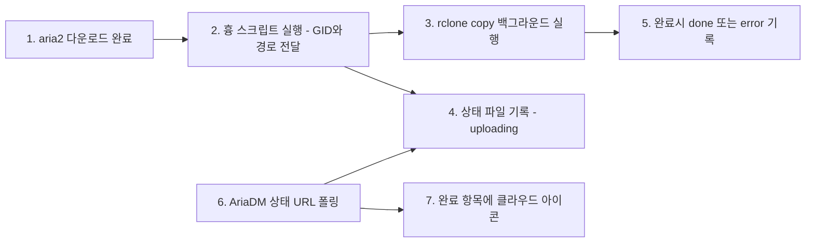

# 클라우드 업로드 연동 (rclone) — Design Spec

> **Date**: 2026-11-21
> **Status**: Approved (brainstorming 완료, 구현 미착수)
> **Scope**: 다운로드 완료 → 클라우드 자동 업로드(서버 측 rclone) + 앱 업로드 상태 표시 · 설정 마법사
> **수익 분류**: Pro 평생 $9.99 (자동화 카테고리)

## 목차

- [개요](#개요)
- [목표 / 비목표](#목표--비목표)
- [배경 — aria2 검증](#배경--aria2-검증)
- [설계](#설계)
- [파일별 변경 (예상)](#파일별-변경-예상)
- [에지 케이스](#에지-케이스)
- [테스트 전략](#테스트-전략)
- [결정 로그](#결정-로그)

## 개요

다운로드 완료 파일을 사용자 클라우드(Google Drive 1순위, rclone remote 전반)로 자동 업로드한다. 전송은 전부 사용자 aria2 서버의 rclone이 수행하고, AriaDM은 설정 마법사와 업로드 상태 표시를 제공한다. aria2 RPC에는 업로드 기능이 없으므로(배경 참조) `on-download-complete` 이벤트 훅을 경유한다.

전송 경로는 aria2 서버 → rclone → 사용자 클라우드다. AriaDM과 ZZiZiLY 서버는 전송에 관여하지 않는다 — ZZiZiLY 반복 비용 0.

## 목표 / 비목표

**목표**

1. 다운로드 완료 시 서버 측 rclone 자동 업로드 — 앱이 전송을 경유하지 않음
2. 앱 업로드 상태 표시 — 상태 파일 폴링, 완료 항목에 클라우드 아이콘
3. 설정 마법사 — 서버 스크립트 생성·복사, rclone 설치·OAuth 가이드
4. rclone remote 일반화 — Google Drive를 1순위 검증 사례로, remote 이름 추상화로 타 클라우드 확장
5. Pro 게이트 지점 정의 — 마법사 진입 + 상태 표시 (v1은 전 기능 무료로 게이트 해제, 체크 코드만 삽입)

**비목표**

1. 앱이 Drive API 직접 호출(서버→폰→클라우드 경유) — 대역폭 2배·모바일 백그라운드 제한·OAuth 민감 스코프 심사
2. 업로드 진행률 % 표시 — rclone stats 로그 파싱이 필요, v1은 3상태(uploading/done/error)만
3. 업로드 재시도·취소 관리, 멀티 remote 전환 UI
4. SSH 등 서버 원격 설치·실행 — 마법사는 텍스트 생성·복사까지만
5. relay push 연동 — 미래 Pro 기능, 본 spec과 독립

## 배경 — aria2 검증

2026-11-21 공식 문서(https://aria2.github.io/manual/en/html/aria2c.html) 기준:

| 항목 | 결과 |
| :--- | :--- |
| RPC 업로드 메서드 | **없음** — addUri·addTorrent·tellStatus 등 전부 다운로드 제어. upload 관련 옵션은 BT 시딩 한정(`max-upload-limit`) |
| `on-download-complete` | **존재** — 완료 시 명령 실행, 인자로 GID·파일 수·파일 경로 3개 전달 |
| BT 시 호출 시점 | 시딩 종료 후. 시딩 전에는 `on-bt-download-complete` |
| `changeGlobalOption` RPC | 이벤트 훅 변경 **불가** — 허용 목록에 훅 없음 → 훅은 aria2.conf 고정, 앱에서 동적 on/off 불가 |

## 설계

### 1. 아키텍처



### 2. 서버 측 — upload-cloud.sh

앱 마법사가 생성한 텍스트를 사용자가 서버에 저장하고, aria2.conf에 `on-download-complete=/path/upload-cloud.sh`로 등록한다.

설정 변수 2개:

```bash
RCLONE_REMOTE="gdrive:Downloads"   # rclone remote:경로
STATUS_FILE="/config/cloud-upload/status.json"
```

동작 순서:

1. 인자 파싱(GID, 파일 수, 파일 경로)
2. 파일 수 0이면 종료 — BT 메타데이터만 완료된 경우
3. 상태 파일에서 해당 gid가 이미 done이면 종료 — BT 이중 훅 방어
4. `status=uploading` 기록(flock)
5. rclone copy 백그라운드 실행 — 완료 시 `done` 또는 `error` + stderr 기록

BT는 기본 `on-download-complete`만 사용한다(시딩 종료 후 업로드). 시딩 전 업로드를 원하는 사용자에게 `on-bt-download-complete` 병용을 가이드로 제공하되, 이중 실행은 3번 방어 로직이 흡수한다.

### 3. 상태 파일 프로토콜

단일 JSON snapshot — 폴링 1 request로 전체 상태 조회.

```json
{
  "version": 1,
  "items": [
    {
      "gid": "2089b05ecca3d829",
      "file": "example.zip",
      "status": "uploading",
      "error": null,
      "ts": 1763680000
    }
  ]
}
```

- `status`: `uploading` | `done` | `error` (`error` 시 `error` 필드에 rclone stderr 요약)
- 항목 최대 200개 캡 — 초과 시 오래된 `done`부터 제거
- 갱신은 flock으로 직렬화(동시 완료 race 방어)

### 4. 앱 측

**프로필 확장** — `features/profiles/store.ts`의 `Profile`에 선택 필드 `cloudStatusUrl?: string` 추가. 미지정 프로필은 기능 전체 비활성(기존 UX 불변). 저장은 기존 구조를 따른다 — secret(SecureStore)과 분리된 일반 필드(MMKV)로 저장하고, 상태 파일에 다운로드 파일명이 포함되므로 URL을 외부에 노출하지 않도록 가이드에 명시한다.

**상태 표시** — 완료(stopped) 세그먼트의 `DownloadRow`·`Detail`에서 gid 매핑으로 클라우드 아이콘 표시. 4상태: 업로드 중(스피너) / 완료 / 실패 / 미연결(회색). 폴링은 기존 tellStatus 폴링 틱에 함께 fetch한다. `uploading`이 오래 지나면(stuck) ts 경과로 구분 표시.

**설정 마법사** — `features/cloud-upload/`(신규). remote 이름·상태 파일 경로 파라미터 입력 → 스크립트 텍스트 생성·클립보드 복사. 가이드 표시: rclone 설치, headless OAuth(`rclone authorize "drive"`), nginx basic auth 권고(상태 파일 무인증 노출 방지).

**Pro 게이트** — `isPro()` 체크 2지점(마법사 진입, 상태 렌더링). v1 전 기능 무료 원칙에 따라 게이트는 해제 상태(`isPro()` 스텁 false 반환)로 두고 체크 호출 지점만 삽입한다.

### 5. 수익 분류 근거

- 기존 로드맵의 '자동화 규칙' 카테고리(Pro)에 속한다
- ZZiZiLY 서버 비용 0 → '비용 구조 일치' 원칙상 일루성 Pro, Cloud 구독이 아니다
- Cloud 구독 제거(단일 Pro 통합) 결정은 본 spec 범위 밖 — ROADMAP.md 별도 갱신 예정

## 파일별 변경 (예상)

| 영역 | 파일 | 변경 |
| :--- | :--- | :--- |
| 서버 스크립트 | `features/cloud-upload/upload-cloud.sh` (마법사 템플릿) | 신규 |
| 프로필 | `features/profiles/store.ts` | `Profile`에 `cloudStatusUrl` 필드 |
| 프로필 | `features/profiles/ProfileForm.tsx` | 폼 항목 추가 |
| 상태 파서·폴러 | `features/cloud-upload/` (신규) | 상태 JSON 파서, 폴러, 매핑 유틸 |
| 마법사 | `app/cloud-upload-wizard.tsx` (신규) | 파라미터 입력·스크립트 생성·가이드 |
| 표시 | `features/downloads/DownloadRow.tsx`, `Detail.tsx` | 클라우드 아이콘 |
| 게이트 | `core/iap/entitlement.ts` 소비 | 체크 지점 2곳 |

## 에지 케이스

1. **BT 이중 훅** — `on-download-complete`와 `on-bt-download-complete` 병용 시 gid done 조회로 방어
2. **BT 메타데이터 완료** — 파일 수 0 → 스킵
3. **멀티파일 토렌트 arg3 해석** (Unverified) — 대표 경로 vs 디렉터리 여부는 구현 시점 실측 검증. 잠정: 파일 수 >1이면 경로의 상위 디렉터리를 업로드 대상으로
4. **업로드 중 서버 재시작** — `uploading` stuck: 앱에서 ts 경과 표시로 구분
5. **rclone 미설치·토큰 만료** — `error` 상태 + stderr 기록
6. **동시 완료 N개** — rclone 백그라운드 병렬 실행, 상태 갱신은 flock 직렬화
7. **상태 파일 무인증 노출** — 파일명 포함이므로 가이드에 basic auth 권고
8. **cloudStatusUrl 미지정** — 폴링·아이콘 전체 비활성, 회귀 없음

## 테스트 전략

- **단위 (TDD)**: 상태 JSON 파서·gid 매핑, stuck 판정(ts 경과), 마법사 템플릿 생성(파라미터 치환), 프로필 `cloudStatusUrl` 저장·조회
- **통합 (`it:docker`)**: docker-compose에 rclone 추가 — 원격을 로컬 경로 remote로 대체해 클라우드 의존 제거. 훅 스크립트·상태 파일 경로를 fileserver에 노출 → 실제 다운로드 완료 → 상태 `done` 전이 E2E 검증
- **수동**: heritage 실서버 + 실제 Google Drive로 1회 검증(OAuth 포함)

## 결정 로그

| 결정 | 내용 | 근거 | 날짜 |
| :--- | :--- | :--- | :--- |
| 전송 주체 | 서버 측 rclone — 앱 직접 업로드 배제 | 대역폭 2배·백그라운드 제한·OAuth 민감 스코프 심사 | 2026-11-21 |
| 수익 분류 | Pro 평생 $9.99 | 자동화 카테고리, ZZiZiLY 비용 0 — 비용 구조 일치 | 2026-11-21 |
| 상태 표시 | 상태 파일 폴링 | relay 이전에 Pro 가치 가시화, docker E2E 가능 | 2026-11-21 |
| 클라우드 범위 | rclone 일반화, Google Drive 1순위 | remote 이름 추상화로 타 클라우드 확장 무비용 | 2026-11-21 |
| Cloud 구독 | 제거·단일 Pro 통합 별도 진행 — ROADMAP.md 갱신 예정 | serverless 스택에서 실제 한계비용 ≈ 0 | 2026-11-21 |
